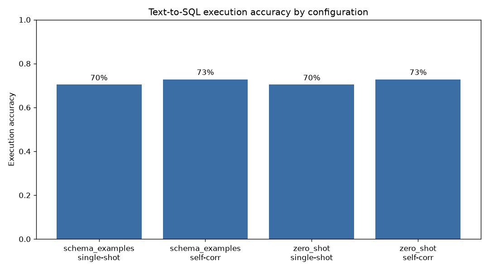

# Text-to-SQL Analytics AI Agent

A tool-using agent that answers plain-English analytical questions over a DuckDB
database of shipping and energy data. The agent inspects the schema, writes a
read-only SQL query, executes it in a sandbox, reads any error and corrects
itself within a bounded number of retries, then returns a result table and, where
the shape allows, a chart. It ships with a self-contained sample database and, as
its headline feature, an evaluation harness that measures execution accuracy,
retries, latency and token usage across prompting strategies.

The agent talks to any OpenAI-compatible chat endpoint. The default target is a
local [Ollama](https://ollama.com) model, so the whole project runs for free with
no account and no network access beyond the initial model download.

## Features

- Natural-language to SQL over a bundled DuckDB database of shipping (AIS-style)
  and energy (EIA-style) data.
- Tool-using loop: schema inspection, SQL generation, execution, and error-driven
  self-correction with a configurable retry budget.
- Read-only, sandboxed execution: only single `SELECT`/`WITH` statements are
  allowed, writes and side-effecting statements are rejected, results are row-
  capped, and every query runs under a wall-clock timeout. The connection is
  opened read-only so the engine enforces immutability as a second line of defence.
- Two interfaces: a Streamlit chat UI and a command-line tool.
- Optional bar charts for two-column numeric results.
- An evaluation harness with a labelled question set (81 questions across easy,
  medium and hard difficulty) that compares prompting strategies and self-
  correction on real, reproducible numbers.
- Provider-agnostic LLM client: local Ollama by default, hosted free-tier
  gateways (for example Groq) via environment variables. Tests use a deterministic
  fake client and never touch the network.

## Results

The evaluation harness was run locally against `qwen2.5:1.5b` served by Ollama on
a CPU-only machine (8 GB RAM, no GPU). Numbers are genuine but reflect a very
small model on modest hardware; a larger model raises accuracy substantially. Run
`python eval/harness.py` to reproduce, or point `T2SQL_MODEL` at a bigger model.

The run covered all 81 questions under each of the four configurations (324 runs).

| Strategy | Self-correction | Accuracy | Easy | Medium | Hard | Mean retries | Mean latency | Mean tokens |
|---|---|---|---|---|---|---|---|---|
| zero-shot | off | 70.4% | 83% | 74% | 45% | 0.00 | 2.47s | 256 |
| zero-shot | on | 72.8% | 83% | 74% | 55% | 0.30 | 4.24s | 416 |
| schema+examples | off | 70.4% | 80% | 71% | 55% | 0.00 | 2.50s | 423 |
| schema+examples | on | 72.8% | 80% | 74% | 60% | 0.28 | 4.61s | 618 |

Findings on this model and hardware:

- Self-correction lifted overall accuracy from 70.4% to 72.8%, and all of that
  gain came on medium and hard questions: zero-shot hard accuracy rose from 45%
  to 55%, at the cost of roughly double the latency and tokens.
- Adding few-shot examples did not improve overall accuracy here (both strategies
  landed at the same headline number), but it shifted where the model did well:
  examples helped on hard questions (45% to 55% single-shot) while slightly
  hurting easy ones, and they roughly doubled prompt tokens. On a small model the
  extra context is a mixed trade rather than a clear win.
- Errors were dominated by the hard questions (subqueries, window-style
  aggregates, duration arithmetic), which is where a larger model would help most.



Full per-question records and summaries are written to `eval/results/results.json`.

Reading the table: **execution accuracy** is the share of questions whose result
set matches the gold query's result set (order-insensitive, with float rounding),
which credits any correct query regardless of how it is phrased. **Self-correction**
lets the agent see its own execution error and try again, which mainly helps on
harder questions at the cost of extra latency and tokens.

## Architecture

```
Question --> Agent ---------> LLM (OpenAI-compatible) --> SQL text
               |                                            |
               |                                     extract + validate
               |                                            |
               v                                            v
        instrumented                               SQL guard (read-only,
        AgentResult <---- result / error -------->  single statement)
                                                            |
                                                            v
                                              DuckDB (read-only, timeout, row cap)
```

On an execution error, the agent appends the failed SQL and the error message to
the conversation and asks the model to fix it, up to `T2SQL_MAX_RETRIES` times.

### Project structure

```
src/text2sql/
  agent.py        Tool-using loop and instrumented results
  db.py           Read-only DuckDB access, schema inspection, safe execution
  sql_guard.py    Read-only / single-statement / row-limit validation
  llm.py          Provider-agnostic chat client plus a deterministic fake
  prompts.py      Prompting strategies, few-shot examples, SQL extraction
  chart.py        Optional bar-chart rendering
  config.py       Environment-driven configuration and .env loader
  sample_data.py  Deterministic sample-database generator
  cli.py          Command-line interface
app/streamlit_app.py   Streamlit chat interface
eval/
  questions.yaml  Labelled question set (question, gold SQL, difficulty)
  harness.py      Evaluation runner, metrics, plots
tests/            Pytest suite (uses the fake LLM, no network)
```

## Tech stack

- Python 3.11
- DuckDB for storage and query execution
- The `openai` client library, pointed at any OpenAI-compatible endpoint
- Ollama for free local inference (default)
- Streamlit for the chat UI, matplotlib for charts, pandas for table display
- pytest for testing

## Data

The bundled database is generated by `src/text2sql/sample_data.py`. The data is
**synthetic**: it is produced deterministically (fixed seed) to mirror the shape
of public maritime AIS vessel-tracking data and EIA energy statistics. It is not
real observational data and should not be presented as such. Port names and
coordinates are public geographic facts. The generated file is a few megabytes and
is not committed; it is rebuilt on demand.

Tables: `vessels`, `ports`, `port_calls` and `energy_prices`. See
`src/text2sql/sample_data.py` for the exact schema and value ranges.

## Getting started

Requires Python 3.11 and, for real answers, [Ollama](https://ollama.com)
installed and running.

```bash
# 1. Environment and dependencies
python3.11 -m venv .venv
source .venv/bin/activate
pip install -e ".[ui,dev]"        # or: pip install -r requirements.txt

# 2. Build the sample database (also happens automatically on first use)
python -m text2sql.sample_data

# 3. Start a local model (one-off download of ~1 GB)
ollama serve &
ollama pull qwen2.5:1.5b
```

Copy `.env.example` to `.env` to change the model or point at a hosted endpoint.

## Usage

Command line:

```bash
text2sql "Which port received the most calls?"
text2sql "Average crude oil price by region" --chart docs/crude.png
text2sql "How many vessels of each type?" --strategy zero_shot --no-self-correction
```

Streamlit chat UI:

```bash
streamlit run app/streamlit_app.py
```

Python:

```python
from text2sql.agent import Agent
from text2sql.db import Database
from text2sql.llm import OpenAIChatClient

with Database("data/sample.duckdb") as db:
    agent = Agent(db, OpenAIChatClient())
    result = agent.answer("Which vessel made the most port calls?")
    print(result.sql)
    print(result.result.rows)
```

## Evaluation

```bash
python eval/harness.py                 # full matrix, writes results + plot
python eval/harness.py --limit 10      # quick subset while iterating
```

The harness runs every question under each prompting strategy
(`zero_shot`, `schema_examples`) with self-correction on and off, compares each
result against the gold query, and writes `eval/results/results.json` plus an
accuracy plot.

## Testing

```bash
pytest -q
```

The suite covers the SQL guard, the database layer, prompt construction and SQL
extraction, the agent loop (including self-correction and giving up), the chart
helper, the sample-data generator and the evaluation harness. Every test uses a
deterministic fake LLM, so the suite is fast and needs no network or model.

## Possible future work

- A schema-linking step that selects only relevant tables for large databases.
- Few-shot example retrieval based on question similarity.
- Point the agent at external DuckDB databases (for example a shipping-traffic or
  energy-fundamentals dataset) via a configuration flag.
- Confidence estimates and clarification questions for ambiguous requests.
- Caching of generated SQL for repeated questions.

## Licence

MIT, see [LICENSE](LICENSE).
